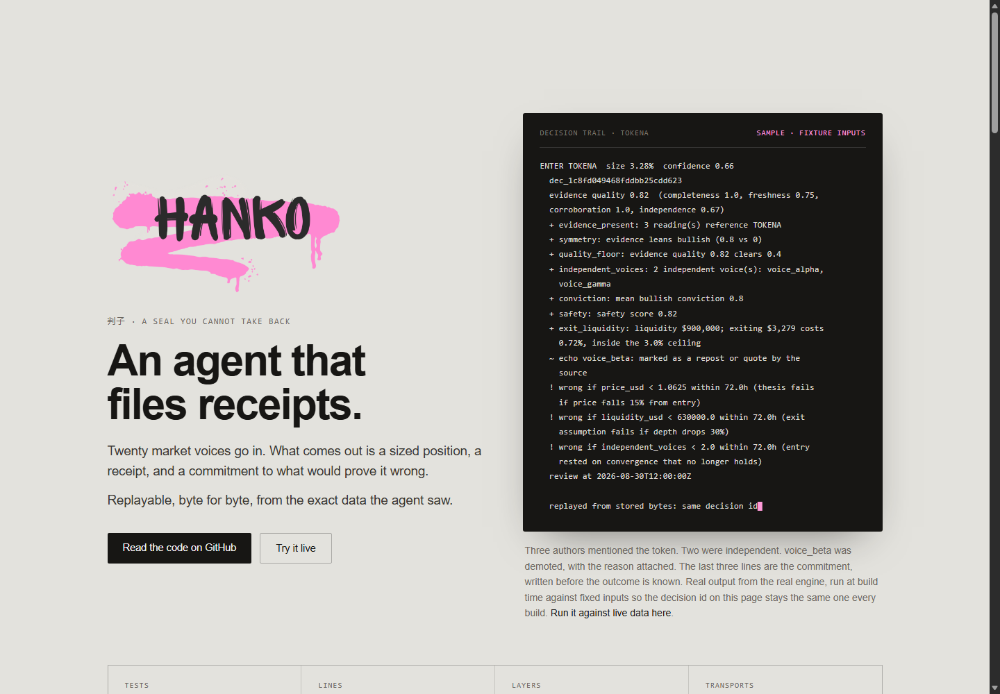
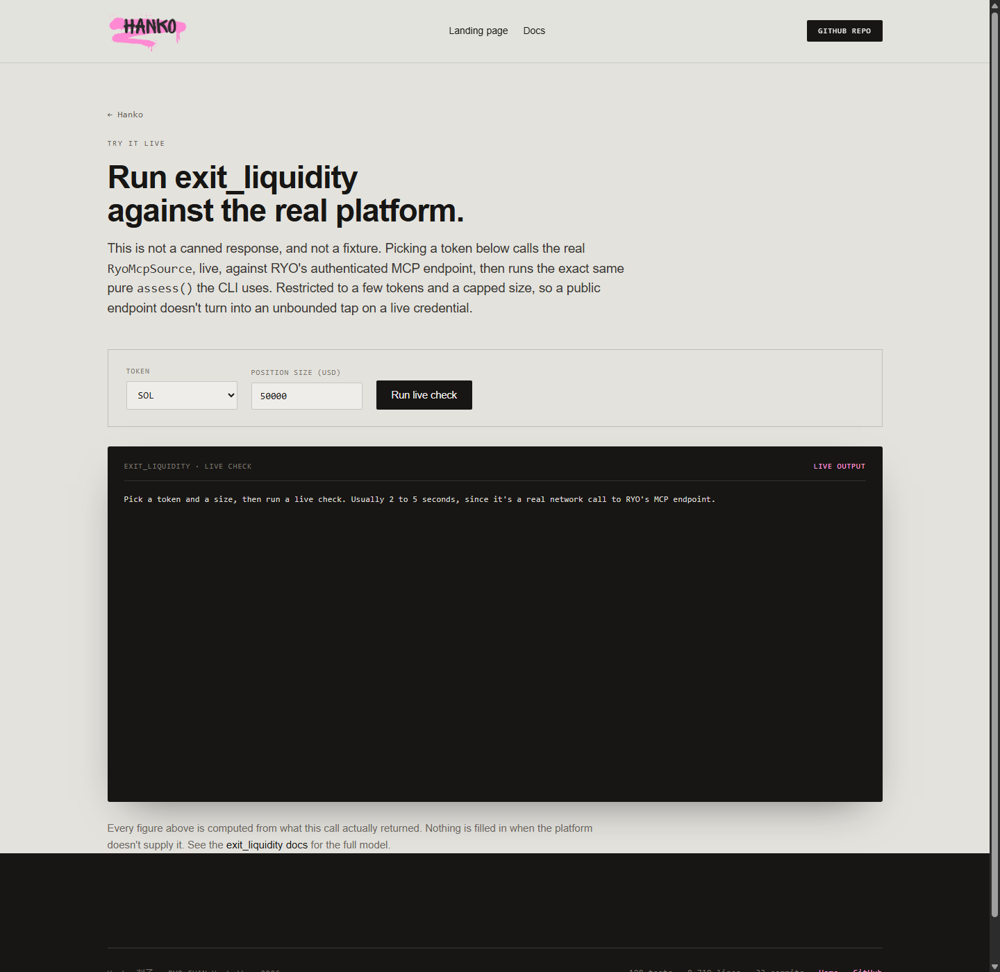
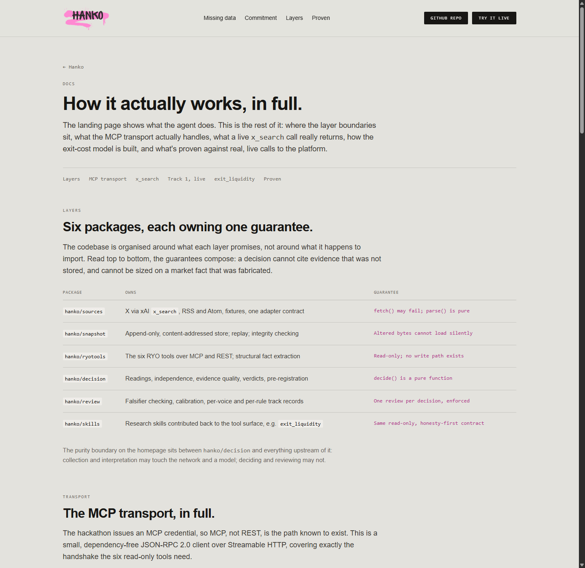

# hanko

<div align="center">

[](https://github.com/IamHarrie-Labs/hanko/actions/workflows/ci.yml)
[](tests/)
[](ARCHITECTURE.md#transport-mcp-and-rest-reach-the-same-facts)
[](https://tryhanko.vercel.app/judges)
[](LICENSE)

</div>

**Hanko turns crypto market chatter into a sized position, or an honest
refusal, with the evidence attached, and can prove that same decision
byte for byte, years later.**

Point it at a token and the voices you trust, on X, Telegram or Bluesky. It
reads what each one actually said, checks whether they're independent voices
or one thesis repeated three times, and decides:

```
ENTER TOKENA  size 3.28%  confidence 0.66
  + independent_voices: 2 independent voice(s): voice_alpha, voice_gamma
  ~ echo voice_beta: marked as a repost or quote by the source
  ! wrong if price_usd < 1.0625 at any point within 72.0h (thesis fails if price falls 15% from entry)
  review at 2026-08-30T12:00:00Z
```

<sub>Sample output: real engine, synthetic inputs. `voice_alpha`/`voice_beta`/`voice_gamma` and `TOKENA` are fictional test fixtures, not real accounts or a real token.</sub>

Run that same input again in a year and it produces the identical decision
id, because nothing about deciding touches the network, a clock, or a model.
It only ever reads what was actually stored. That's the whole project: an
architecture that makes "prove it" a command you can run, not a promise in
this README.

**Judging? Start at [/judges](https://tryhanko.vercel.app/judges)**: every line of
the published rubric, mapped to a page or command you can check yourself.
**[tryhanko.vercel.app](https://tryhanko.vercel.app)** has the pitch and a sample
receipt (synthetic inputs, labelled). **[/try](https://tryhanko.vercel.app/try)** runs a piece of it, live,
from your browser, no install. Full technical detail is at `/docs`.



---

**RYO-CHAN Hackathon 2026 submission, three tracks.** **Track 1 (Autonomous
Agents)** is the agent above, built to the Multi-KOL Narrative Agent spotlight.
**Track 3 (New Skills)** is [`exit_liquidity`](hanko/skills/exit_liquidity/README.md):
what it costs to get *out* of a position, from an executable venue quote where
one exists, in RYO's own response envelope. It is also the size gate the agent
runs before committing. **Track 2 (Dashboards & Interfaces)** is three screens:
the [workbench](https://tryhanko.vercel.app/workbench), the
[failure drill](https://tryhanko.vercel.app/drill) and the
[Echo Index](https://tryhanko.vercel.app/echo).

### What it has shown, live

- **A ledger that grows every three hours, with no key.** A scheduled
  workflow reads public Telegram, Bluesky and news voices on BTC, ETH, SOL
  and BONK, decides, seals the run with its replay bundle, stamps it on
  OpenTimestamps and commits it to [`live/`](live/). Every decision is graded
  72 hours later against the conditions it wrote down first.
  [/ledger](https://tryhanko.vercel.app/ledger) shows what changed since the
  last run, most important first (D-20).
- **Graded against its own conditions, including when it was wrong.** The
  first 32 scheduled decisions came due on 2026-10-27 and 28: every ENTER
  held (7 of 7, realised returns between -0.9% and +1.1%), and 7 of 25
  refusals were proved wrong because a voice they said would flip them
  arrived. Those reviews also exposed two grading bugs, fixed in D-21.
- **A sealed live ENTER that anyone can re-derive.** BTC, 2026-10-23,
  `runs/run_836b976720f63dc0.json`. The manifest lists every watchlist entry,
  including the PASS and both ABSTAINs. It is anchored in Bitcoin block
  972,817, mined 35 minutes after the seal, and `hanko verify-run` replays
  all four decisions from the committed bundle with no network and no key.
  (Until 2026-10-24 that bundle was not actually in the repository; D-19.)
- **An exit cost measured, not modelled.** BONK, $50,000: the Jupiter quote
  says 2.3%. The skill's own constant-product model said 7.2%, and the report
  prints the 3.1x gap instead of hiding it.
- **A study that audited the agent.** The [Echo Index](study/echo-index/REPORT.md)
  ran Hanko's echo check over 2,094 real posts from 15 crypto channels. Echo
  inflation was 1.005x, published as found. First, though, it found that
  Hanko's own detector missed verbatim copies padded with an ad or a footer
  (D-14, fixed).
- **Nine failures injected on purpose.** RYO down, every source down, a
  rate-limited quote venue, the model down, a prompt injection the model
  actually obeyed, tampered evidence, an edited sealed run, a source dying
  mid-sweep, a restart. All nine hold, computed live on
  [/drill](https://tryhanko.vercel.app/drill). The restart scenario broke the
  first time it ran (D-18, fixed).

A 判子 is the seal a person stamps on a document to commit to it. The mark
goes on before the outcome is known and can't be taken back, which is exactly
what this agent does with every decision it makes: sizes it, commits to it,
and states in advance what would prove it wrong.

## Submission

- **[Project Submission Form](RYOCHAN-Project-Submission-Form.pdf)** (PDF, this repo)
- **[Demo video](https://youtu.be/fm0B4hZQCwQ)**
- **[Announcement post on X](https://x.com/IamHarrie/status/2096908693967179844?s=20)**

## Contents

- [Verify it yourself in 60 seconds](#verify-it-yourself-in-60-seconds)
- [Who this is for](#who-this-is-for)
- [Explore without running anything](#explore-without-running-anything)
- [The one rule](#the-one-rule)
- [Layout](#layout)
- [Why it is built this way](#why-it-is-built-this-way)
- [Use](#use)
- [Status](#status)
- [exit_liquidity, the new Track 3 skill](#exit_liquidity-the-new-track-3-skill)
- [Decision records](#decision-records)
- [The review loop](#the-review-loop)
- [The sweep](#the-sweep)
- [Architecture, decisions, limitations](#architecture-decisions-limitations)

## Verify it yourself in 60 seconds

No live credential, no account, no network. Every number below regenerates
from synthetic fixtures committed in this repository (fictional sample voices
and a fictional token, written for testing, not captured from real accounts):

```bash
git clone https://github.com/IamHarrie-Labs/hanko && cd hanko
pip install -e ".[dev]"

pytest                                          # 349 tests, offline, ~20s

# make a decision, then prove it replays from stored bytes
hanko decide x --token TOKENA --subject voice_alpha --subject voice_beta \
  --subject voice_gamma --market fixtures/market_tokena.json \
  --as-of 2026-08-27T12:00:00Z --fixture fixtures/x_three_voices.json
hanko audit                                     # re-derives it, insists it reproduces

# the Track 3 skill, against the same fixture, no network
hanko exit-liquidity TOKENA --size 50000 --market fixtures/market_tokena.json

# the first live ENTER, re-derived from its committed bundle
hanko verify-run runs/run_836b976720f63dc0.json

# break it on purpose: nine failure scenarios, offline
python -c "from hanko.drill import run; print([r['held'] for r in run()])"

# re-derive every number in the Echo Index
hanko echo-index publish
```

## Who this is for

Builders and traders who want an agent's reasoning to be auditable rather
than taken on faith. Someone who has been burned by a bot that says
"strong buy signal" with nothing behind it, and wants to see the evidence,
the falsifiers, and the honest gaps instead. Also the judges reviewing this
submission, who can replay any decision from the exact stored bytes it saw
rather than trusting a claim in this README.

Not built for anyone who wants the agent to execute trades. It doesn't, and
by the hackathon's own rules, none of the RYO tools it's built on can either.
Everything here researches and sizes a position; nothing here moves funds.

## Explore without running anything

| Open | What it shows |
|---|---|
| [tryhanko.vercel.app](https://tryhanko.vercel.app) | The pitch, and a sample decision receipt (real engine, synthetic fixture inputs, labelled as such) |
| [/try](https://tryhanko.vercel.app/try) | `exit_liquidity` live: RYO facts, DexScreener depth, a Jupiter quote, in RYO's envelope |
| [/judges](https://tryhanko.vercel.app/judges) | Every rubric line, mapped to where to check it |
| [/workbench](https://tryhanko.vercel.app/workbench) | Remove a voice or tighten a threshold on the sample decision (synthetic inputs, labelled as such) and watch the actual `decide()` verdict move, and which rule caused it |
| [/drill](https://tryhanko.vercel.app/drill) | Nine real failures injected into the real code, each defence computed live |
| [/echo](https://tryhanko.vercel.app/echo) | The Echo Index: how much crypto consensus is one voice repeated, on 2,094 real posts |
| [/docs#track1-live](https://tryhanko.vercel.app/docs#track1-live) | Two real decisions, live X evidence and live RYO facts, neither cherry-picked |
| [/docs#mcp-transport](https://tryhanko.vercel.app/docs#mcp-transport) | What a live MCP handshake and a live `x_search` call actually return |

<table>
<tr>
<td width="50%"></td>
<td width="50%"></td>
</tr>
<tr>
<td align="center"><code>/try</code>, live against the real platform</td>
<td align="center"><code>/docs</code>, the full technical writeup</td>
</tr>
</table>

## The one rule

```
fetch()  touches the network, is allowed to fail, and is never deterministic
parse()  touches nothing, and is a pure function of its payload
```

The agent only ever sees the output of `parse()`. Because `parse()` is pure and
payloads are content-addressed, any past decision can be re-derived from stored
bytes and must reach the same verdict. Put a network call inside `parse()` and
the reasoning trail stops being reproducible, and that property is what the
whole submission rests on.

## Layout

```
hanko/provenance.py      canonical JSON, sha256 addressing, Status, Coverage
hanko/evidence.py        Evidence + Provenance: the source-agnostic unit
hanko/sources/base.py    the adapter contract
hanko/sources/xsearch.py X, via the xAI Responses API and its x_search tool
hanko/sources/rss.py     RSS/Atom: free, and the only source with trustworthy timestamps
hanko/sources/fixture.py local JSON: free development, and every failure mode in CI
hanko/snapshot/store.py  append-only content-addressed store, replay, integrity
hanko/ryotools/          the six RYO tools over MCP and REST; structural fact extraction
hanko/skills/exit_liquidity/  Track 3: what it costs to exit a position, not just enter one
hanko/review/outcome.py     grading a decision against its own commitment
hanko/review/reliability.py calibration, per-voice and per-rule track records
hanko/review/ledger.py      append-only reviews, one per decision
hanko/cli.py             collect / decide / review / scorecard / audit / verify
```

Full tree:

```
hanko/
  sources/       X, RSS, fixtures -- fetch() impure, parse() pure
  snapshot/       append-only content-addressed store
  ryotools/       the six RYO tools, MCP + REST
  decision/       evidence quality, verdicts, falsifiers, the ledger
  review/         falsifier checking, calibration, reliability
  skills/exit_liquidity/   Track 3: exit cost, capacity, drift, turnover
  sweep.py, cli.py, config.py, provenance.py, evidence.py
site/            static landing page, /docs, /try -- the live web demo
  api/exit_liquidity.py    the /try endpoint, real assess() call, no fixture
tests/           349 tests, one file per hanko/ package
fixtures/        evidence and market fixtures used offline and in CI
.github/workflows/ci.yml       pytest on every push, Python 3.11 and 3.12
.claude/skills/hanko-exit-liquidity/SKILL.md   packages exit_liquidity as a Claude Skill
ARCHITECTURE.md  the one rule, the pipeline, the layers
DECISIONS.md     engineering decisions and the bugs that shaped them
LIMITATIONS.md   what hasn't been shown yet, and why
LICENSE          MIT
```

## Why it is built this way

**Sources are interchangeable.** The agent never learns where a piece of
evidence came from. Swapping X for Telegram, or Grok for a direct API, changes
one adapter and nothing downstream. If `x_search` is deprecated or priced out on
day 9, nothing else moves.

That swap is a real, considered option, not a hypothetical one: X's own API
returns structured posts directly, with no model paraphrasing a prose summary
in between, at the cost of a separate paid tier and a different credential
than the one this build already has. Worth doing later; not worth the rewrite
risk this close to submission when the adapter boundary already makes it
cheap whenever it happens.

**Failure is data, not an exception.** A source that was asked and did not
answer produces a `FAILED` snapshot with the reason attached. An adapter that
raises produces one too. Silence is the single outcome this store cannot
represent, which is what lets position sizing respond honestly to missing
evidence instead of quietly proceeding as if the data were there.

**Three different kinds of nothing stay distinct.** `FAILED` (the source did not
answer), `OK` with zero items (nobody posted), and `PayloadShapeError` (bytes
arrived that we cannot read) are separate facts. Collapsing them would let a
schema change look like a quiet market.

**Coverage is never overclaimed.** `x_search` is a search tool, not a timeline
feed, so its coverage is `UNKNOWN` by construction. Claiming `COMPLETE` is
precisely the lie that would inflate a convergence count across KOLs.

**Collect once, develop free.** Real snapshots are captured once and everything
afterwards runs against stored bytes. Development and CI cost nothing and hit no
rate limit. At an hourly sweep over 20 handles, live collection runs about
$0.005/call, roughly $25 to $35 for the whole build.

## Use

```bash
pip install -e ".[dev]"
pytest
```

```bash
hanko collect x --subject voice_alpha --subject voice_beta
hanko collect rss --subject https://example.com/feed.xml
hanko ls
hanko replay snap_7723f3520b7dfa2efa6856e3
hanko verify
```

Offline, against a fixture:

```bash
hanko collect x --subject voice_alpha --fixture fixtures/x_three_voices.json
```

`XAI_API_KEY` must be set for live X collection. Without it the adapter records
a `FAILED` snapshot saying so, rather than throwing.

## Status

349 tests, all offline, ~20s. Covered at the evidence layer: canonical form and
address stability, payload deduplication, tamper detection, adapter-version
mismatch on replay, replay determinism, evidence identity pinned to bytes and
position, and each failure mode (rate limit, partial window, empty result,
raising adapter, malformed feed, unreadable payload). At the decision layer:
echo demotion, PASS vs ABSTAIN separation, mechanical size reduction under
missing safety data / a failed source / stale evidence, falsifier generation for
both entries and refusals, ledger tamper detection, and end-to-end reproduction
of a stored decision from stored bytes. At the review layer: falsifier checking,
profit not rescuing a falsified thesis, uncheckable metrics staying unresolved,
inconclusive reviews excluded from every rate, echoes earning neither credit nor
blame, calibration, and the refusal to re-review a decision.

At the MCP layer: the JSON-RPC handshake, session handling, SSE decoding, every
transport failure mode, and a test asserting that facts extracted from an MCP
payload are identical to facts extracted from a REST payload.

**Confirmed against the live API, 28 Aug 2026.** `x_search` does not return
structured post objects. It returns the model's *prose* rendering of the posts
plus an array of URL citations. Prose cannot be attributed to a specific post,
so the adapter requests a JSON schema and then verifies every returned post id
against the tool's own citations: cited posts are kept, uncited posts are
dropped. That check proves a post exists and that the tool saw it; it does not
prove the model transcribed the text or timestamp faithfully, so those fields
are flagged as model-transcribed on every item.

**Confirmed against the live RYO MCP server, 5 Sep 2026.** `hanko tools`,
`hanko facts SOL`, and `hanko decide` have all run against the real endpoint,
not a fixture. Three things that changed once the guessing stopped:

  The catalog is six tools, not the seven the hackathon's own public tool list
  names. `check_safety` and `supported_tokens` are not on the authenticated
  catalog; `monitor_market_sentiment_shift` is, and wasn't guessed at all.
  There is no numeric safety score anywhere in the six, so `safety_score` on
  `MarketFacts` now stays `None` every time, honestly, rather than sometimes.

  Argument keys are `symbol` (`analyze_token`, `deep_analysis`) and `symbols`
  as one comma-separated string (`compare_tokens`), not `token`. Both
  transports were built guessing the latter and are now fixed to match.

  The response is `{"tool": ..., "result": {envelope}, "latency_ms": ...}`
  over REST, and the envelope's own `status` (`ok` / `partial` /
  `unavailable`) and `data_mode` (`live` / `mixed` / `simulated` / `unknown`)
  are what `_degraded()` now reads. A response that admits to being
  `simulated` is treated exactly like a partial one, since simulated data
  presented as live is the one fabrication the platform says it never does.

> **Correction, 22 Sep 2026.** A routine `hanko audit` crashed outright with
> `PayloadShapeError: no message item in the response output`. The cause was
> a labelling bug: a decision built from local fixture data had been tagged
> with the *live* X source's own id instead of anything marking it as a
> fixture, so replay handed the real adapter bytes it was never built to
> read. Every existing replay test had missed it, because each one supplied
> its own resolver that returned a fixture unconditionally rather than going
> through the same lookup `hanko audit` actually uses. Full write-up, the
> fix, and the regression test that proves it, in
> [`DECISIONS.md`](DECISIONS.md) D-07.

Not yet shown: a calibration curve from real outcomes, a live `ENTER`, and a
real priced pool. Stated plainly, with why, in
[`LIMITATIONS.md`](LIMITATIONS.md).

## exit_liquidity, the new Track 3 skill

The six real tools all answer some version of *is this worth entering?*
Nothing answers *can this position be closed, and what does closing it cost?*
That's the number that turns research into a trade. A token can clear every
measured signal and still be a trap if exiting the position moves the price
double digits.

```bash
hanko exit-liquidity BONK --size 50000
```

```
OK  BONK  confidence high
  price $0.00000331 · 24h volume $1,395,538  (dexscreener)
  quoted: selling ~$50,000 on jupiter returns $48,886, 2.34% under its own near-mid rate (price impact plus fees, 5-hop route)
  model said 7.15% from $1,299,172 of on-chain depth
  the model overstates this exit's cost 3.1x: the route reaches concentrated liquidity a constant-product curve cannot see
  depth: 29 pools on solana, deepest $327,472, 1 rejected
  or exit over 8.6h at 10% of volume
  verdict from an executable jupiter quote; quotes move with the market
```

Live output from 2026-10-23, while RYO's own market tools were failing. RYO
has never published pool depth, so version 2.0 asks two keyless venues.
DexScreener supplies pools for the token's canonical contract: never searched
by symbol, because that returns impostor pools. Jupiter supplies an executable
quote for the exact size. A measured quote outranks the model, and the
model's error is printed beside it. Where neither venue answers, cost fields
are null, never zero. Every answer is RYO's public response envelope, also
served on RYO's own REST route shape (`POST /api/tools/exit_liquidity/call`)
and as an MCP server (`/api/mcp`).

Full model, honesty conventions, and test coverage in
[`hanko/skills/exit_liquidity/README.md`](hanko/skills/exit_liquidity/README.md).
Runnable live, against the real platform, at
**[tryhanko.vercel.app/try](https://tryhanko.vercel.app/try)**, restricted to
a few tokens and a capped size, so a public page can't turn into an unbounded
tap on a live credential.

### Claude Skill

[`.claude/skills/hanko-exit-liquidity/SKILL.md`](.claude/skills/hanko-exit-liquidity/SKILL.md)
packages this exact command as a Claude Skill: point Claude Code at this repo
and it can answer "what does it cost to exit this position" directly, scoped
by an explicit rule that every number in the answer has to come from the
command's own output, never invented or rounded by the model. The same
honesty convention the tool enforces on itself, extended to whoever is
running it.

## Decision records

A record states, at the moment of the decision: what was concluded, on what
evidence, by what reasoning, what was missing, and **what would prove it wrong**.

```
hanko/decision/reading.py      interpretation, recorded once and frozen
hanko/decision/convergence.py  independence: is this many voices, or one echoed?
hanko/decision/quality.py      gaps, and the evidence-quality score that sets size
hanko/decision/policy.py       risk limits, hashed into every record
hanko/decision/engine.py       the verdict function -- pure by contract
hanko/decision/record.py       the record, and the commitment that names it
hanko/decision/ledger.py       append-only ledger, and the replay proof
```

**The engine is pure.** `decide()` reads its arguments and nothing else: no
clock, no network, no model call, no randomness. Interpretation is the one
subjective step, so it happens upstream and is frozen into the record. Put an
LLM in the decision path and replay proves nothing.

**Three verdicts, not two.** `ENTER`, `PASS` (the evidence was adequate and
argued against it), and `ABSTAIN` (the evidence was not adequate to argue either
way). Collapsing the last two would let the agent claim a market view it never
had.

**Missing data shrinks the position, mechanically.** No rule says "if safety is
unavailable then halve". A gap lowers completeness, completeness lowers evidence
quality, and quality sets size. The four quality components combine as a
weighted *geometric* mean, so a component at zero takes the whole score to zero.
Enthusiasm can't average away an absent safety check.

**Agreement is checked for independence.** Three accounts quoting one thesis is
one observation in disguise, and counting it as three is the easiest way for a
multi-KOL agent to be confidently wrong. Every echo is recorded with the post it
repeats and the reason it was demoted.

**Every decision pre-registers its own falsification.** Falsifiers are written
before the outcome is known, evaluate mechanically, and are hashed into the
`decision_id`. Move a threshold, a size, or a review date after the fact and you
get a different id: a new decision, not an edited one. Refusals commit too: a
`PASS` records what would flip it.

### Seeing it

```bash
hanko decide x --token TOKENA --subject voice_alpha --subject voice_beta --subject voice_gamma --market fixtures/market_tokena.json --as-of 2026-08-27T12:00:00Z --fixture fixtures/x_three_voices.json
```

```
ENTER TOKENA  size 3.28%  confidence 0.66
  dec_1c1fb9e7ae2020cb260d6f32
  evidence quality 0.82  (completeness 1.0, freshness 0.75, corroboration 1.0, independence 0.67)
  + independent_voices: 2 independent voice(s): voice_alpha, voice_gamma
  + safety: safety score 0.82
  ~ echo voice_beta: marked as a repost or quote by the source
  ! wrong if price_usd < 1.0625 at any point within 72.0h (thesis fails if price falls 15% from entry)
  ! wrong if independent_voices < 2.0 at review, within 72.0h (entry rested on convergence that no longer holds)
  review at 2026-08-30T12:00:00Z

  replayed from stored bytes: same decision id
```

Three authors mentioned the token; two of them were independent. Swap in the
market fixture with no safety score and the same evidence sizes at 3.08%
instead of 3.28%. Nothing in the rules changed, only what was known.

`hanko audit` re-derives every recorded decision from stored bytes and insists it
reproduces. That is the CI gate that turns "preserves a repeatable reasoning
trail" from a README claim into a failing build.

## The review loop

At `review_at`, each falsifier is evaluated against observed facts and the
decision is graded **against what it committed to**, not against whether it
happened to make money.

Those come apart more often than is comfortable. An entry can be profitable and
still falsified: the price rose while the liquidity that justified the size
drained away, meaning the reasoning was wrong and the outcome was luck. Both
facts are recorded and reported separately. Grading on profit alone is how an
agent learns to repeat lucky mistakes.

**The third outcome carries the weight.** When the metric a falsifier names is
unavailable at review time, the check is `UNCHECKABLE`, never quietly counted
as passing. A decision that could not be checked is not a decision that was
right. Inconclusive reviews are excluded from every rate and reported as their
own number, because an agent that silently drops what it could not verify is
grading itself on a sample it chose after the fact.

**Refusals are graded too.** A `PASS` commits to what would have flipped it, so
an agent that only marks the trades it took never learns what its caution cost.

**One review per decision, enforced.** Re-reviewing until the answer improves is
the exact failure pre-registration exists to prevent, so the ledger refuses a
second review rather than keeping the latest.

```bash
hanko review --observations fixtures/observations_day3.json --now 2026-08-30T12:00:00Z
```

```
FALSIFIED  TOKENA  (enter at confidence 0.66)
  dec_1c1fb9e7ae2020cb260d6f32 -> rev_24903844c6020591a568451b
  x price_usd observed at 1.02 at 2026-08-30T12:00:00Z; committed to being wrong if < 1.0625 at any point in the window -- thesis fails if price falls 15% from entry
  + liquidity_usd held against < 630000.0 across 1 sample at 2026-08-30T12:00:00Z -- no intermediate readings; last observed 880000.0
  + independent_voices observed at 2.0; holds against < 2.0
  realised return -18.4%  (recorded, not used to grade)
```

The `liquidity_usd` line says exactly what it checked: one reading, no
intermediate ones. `price_usd` and `liquidity_usd` are graded against every
sample `hanko sweep --samples` logs between the decision and the review
([D-13](DECISIONS.md#d-13-a-falsifier-said-within-72h-and-only-checked-the-last-tick)) --
a breach that recovers before review time still falsifies the thesis it
broke, and a review built from a single end-of-window reading says so
rather than implying it watched the whole window.

### The scorecard

```bash
hanko scorecard
```

```
reviewed 2   scored 2   unverifiable 0
held 1   falsified 1   hit rate 50.0%   brier 0.2461

calibration        said     actual    n
  0.6-0.8         0.7       50.0%    2

voices
  voice_gamma               0.0%   1 scored
  voice_alpha              50.0%   2 scored

rules satisfied on decisions that later
  independent_voices       0.0% held
  conviction              50.0% held
```

Said 0.7, was right 50% of the time. The agent is overconfident, and says so.

Per-voice reliability is **earned from the agent's own audited history**, not
asserted from follower counts, and echoes earn neither credit nor blame. A voice
with no scored decisions gets `None`, not 0%. Reporting it as zero would defame
it; reporting it as 100% would promote it. Per-rule reliability answers the
uncomfortable question: a rule that is always satisfied on losers is not a
filter, it is decoration.

## The sweep

`hanko decide` handles one token, from one source, by hand. A real watchlist
needs the same thing done for twenty tokens across several sources on a
schedule, without one dead source or one bad token taking the rest of the
run down with it. `hanko/sweep.py` is that orchestration.

```bash
hanko sweep --watchlist watchlist.json --as-of 2026-08-27T12:00:00Z
```

One pass: decide on every entry in the watchlist, then grade every decision
the ledgers say is due. A failing token is recorded in the report and the
sweep moves past it rather than raising; a token dropped from the watchlist
still gets its outstanding decisions reviewed rather than orphaned.

**Every snapshot in one sweep is stamped at the sweep's own `as_of`, not the
literal wall clock.** The several source calls inside one pass take a few
real seconds, but they all belong to the same logical instant, and a sweep
re-run against unchanged sources should reach the same `decision_id` rather
than a new one just because the retry landed a second later.

**Review uses a fresh look, not the frozen one.** `fresh_observations()`
re-collects evidence and re-derives `independent_voices` at review time
rather than reusing the original decision's numbers. The whole point of a
review is what's true *now*; a stale copy of "true then" would grade a
decision against itself.

**`--samples samples.jsonl` gives the window something to actually check.**
Every pass appends one market reading per watched token, reusing the facts
that pass already fetched. A decision that becomes due later is graded
against every reading logged since it was made, not just the one taken at
review time -- which is what lets an `ANY_POINT_IN_WINDOW` falsifier
([D-13](DECISIONS.md#d-13-a-falsifier-said-within-72h-and-only-checked-the-last-tick))
catch a price or liquidity breach that recovers before the clock gets there.
Omit it and `hanko sweep` keeps the single end-of-window reading it always
took; the review says which of the two it used.

Meant to be invoked by something that already knows how to schedule things:
cron, a scheduled GitHub Action, Windows Task Scheduler. One pass and exit,
not a loop that sleeps in-process. A failed run is a failed invocation, not a
process to go find and kill.

This repository runs one. [`.github/workflows/sealed-sweep.yml`](.github/workflows/sealed-sweep.yml)
seals [`watchlist.live.json`](watchlist.live.json) every three hours with no
key at all, then verifies the run from its committed files, upgrades any
pending Bitcoin proofs, and writes `live/summary.json` for
[/ledger](https://tryhanko.vercel.app/ledger):

```bash
hanko seal --watchlist watchlist.live.json --ledger live/decisions.jsonl   --reviews live/reviews.jsonl --samples live/samples.jsonl   --manifest-dir live/runs --interpreter lexicon --lookback-hours 24 --ots
hanko live-summary --dir live
```

`--interpreter lexicon` is the keyword reader taught to recognise "Bitcoin"
as well as "$BTC", matching words whole. `--lookback-hours 24` reads only
the last day of a feed, since a Telegram page or an RSS feed keeps days of
history that would otherwise score as stale (D-20).

```bash
hanko sweep --watchlist fixtures/sweep_demo/watchlist.json \
  --fixture-dir fixtures/sweep_demo --as-of 2026-08-27T12:00:00Z
```

```
sweep at 2026-08-27T12:00:00+00:00
  ENTER   TOKENA  dec_5b2eadbf21bc8c073927b4ac
```

16 tests, all offline, using a fixture stand-in for RYO tool responses
(`FixtureFactsSource`, shaped like the live tool sources rather than the
evidence-shaped `FixtureSource`) alongside the existing evidence fixtures.
Covered: a failed evidence source or fact tool becoming a gap rather than an
exception, one bad token not cancelling the rest of the sweep, a decision
already in the ledger being skipped rather than duplicated, a token dropped
from the watchlist still getting reviewed, and review pulling fresh
observations rather than the ones frozen into the original decision.

## Architecture, decisions, limitations

- **[`ARCHITECTURE.md`](ARCHITECTURE.md)**: the one rule, the pipeline as a
  diagram, what each package owns, and how `exit_liquidity` sizes itself as
  the same size gate `decide()` runs internally.
- **[`DECISIONS.md`](DECISIONS.md)**: thirteen engineering decisions in the
  order they happened, including several real bugs found and fixed during
  this build and what each one actually broke.
- **[`LIMITATIONS.md`](LIMITATIONS.md)**: what hasn't been shown yet, a
  calibration curve from real outcomes, a live `ENTER`, a real priced pool.
  Stated plainly, not folded into a status paragraph.
- **[`SEALING.md`](SEALING.md)**: `hanko seal` -- a numbered manifest of an
  entire watchlist run (nothing omitted, not even the errors), anchored to
  public OpenTimestamps calendars, published before the outcome is known.

## Next

Wire `sweep`, `audit`, and `scorecard` into CI or a scheduled run, and feed
per-voice reliability back into evidence weighting so the agent's own track
record starts shaping what it believes.
# Evidence update, 30 Oct 2026

Hanko 2.0.0 is published in the official MCP registry as `io.github.IamHarrie-Labs/hanko`.

- [Retrospective baseline comparison](study/baseline/README.md): the first 32 eligible reviewed opportunities produce identical entry selections under Hanko and a simple rule. This sample establishes no selection advantage. Reproduce with `python scripts/compare_baseline.py`.
- [A sealed SOL refusal proved wrong](study/baseline/failure-case.md): the original commitment, late review-time observations, and what the extra voice does and does not establish.
